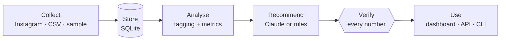

# Instagram Content Intelligence System (ICIS)

Collects Instagram post data, analyses what performs, and recommends what to post next. Every recommendation cites the numbers behind it, and those numbers are automatically checked against the data.



- **[TECHNICAL.md](TECHNICAL.md)**: architecture, metric choices and key decisions
- **[AI_USAGE.md](AI_USAGE.md)**: how AI coding tools were used, the guardrails, the bugs found and how they were verified

## Requirements

- Python 3.9+
- Optional: a Claude API key, for AI caption tagging and recommendations
- Optional: an Instagram Business or Creator account connected to a Meta app, for real data

## Install

```bash
python3 -m venv .venv
source .venv/bin/activate
pip install -r requirements.txt
cp .env.example .env
```

## Run

### Web dashboard

```bash
uvicorn api:app --port 8000
```

Open **http://127.0.0.1:8000**. Don't open `static/index.html` directly: the page needs the server.

1. Choose **Sample data** or **My Instagram**, then click **Sync posts**.
2. Optionally describe the account, e.g. "Coffee roaster selling online. Goal: website sales".
3. Click **Analyse & recommend**.

The dashboard shows:
- headline numbers
- recommendations, each with a "numbers verified" badge
- underperforming areas, with suggestions
- key insights
- engagement over time
- a breakdown by format, topic, style, day, time, hashtags, caption length, call to action, questions and emoji
- the best and worst posts
- the exact data the intelligence layer received

### Command line

```bash
python main.py run                                   # sample data → output/report.md + report.json
python main.py run --source instagram --context "…"  # your Instagram account
python main.py run --source csv --path posts.csv     # a CSV export
python main.py analyse --no-llm                      # analyse stored posts without AI
```

### Tests

```bash
pytest
```

The tests use fake Instagram and Claude responses, so they need no keys and no network.

## Configure (`.env`)

| Variable | Needed for | Notes |
|---|---|---|
| `ANTHROPIC_API_KEY` | AI tagging and recommendations | From console.anthropic.com → API Keys. Without it, everything runs rule-based |
| `IG_ACCESS_TOKEN` | Real Instagram data | See below |
| `IG_USER_ID` | Facebook-style tokens (`EA…`) | The Instagram account ID shown in the Meta app dashboard |
| `IG_API_VERSION` | Optional | Graph API version, default `v23.0` |
| `ACCOUNT_TIMEZONE` | Optional | e.g. `Africa/Accra`. Posting times are analysed in this zone (default UTC) |
| `CLAUDE_MODEL` | Optional | Default `claude-opus-5-5` |

### Connecting Instagram

1. Make the Instagram account a **Business or Creator** account (Instagram → Settings → Account type and tools).
2. At developers.facebook.com, **Create App** with the use case "Manage messaging & content on Instagram", then connect a business portfolio.
3. In **Use cases → Customize → API setup**:
   - Create or select a configuration that includes the **insights** permission.
   - Add the account as an **Instagram Tester** (App roles → Roles), and accept the invite in Instagram.
   - Click **Generate token** next to the account.
4. Put the token in `.env` as `IG_ACCESS_TOKEN`.
   - Tokens starting with `IG` work as they are.
   - Tokens starting with `EA` (Facebook or system-user tokens, which never expire) also need `IG_USER_ID`.

## Data sources

| Source | Use |
|---|---|
| `instagram` | Instagram Graph API: posts, likes, comments, and insights (reach, saves, shares, views) |
| `mock` | `data/sample_posts.json`: 96 simulated posts for a fictional coffee brand, with known patterns built in. Regenerate with `python scripts/generate_mock_data.py` |
| `csv` | Any CSV with `id, media_type, timestamp` (plus optional `caption, likes, comments, saves, shares, reach, views, permalink`) |

To add a source, write a class with `fetch_posts()` that returns `Post` objects and register it in `insights/sources.py`. Nothing else changes.

## Project layout

```
insights/
  models.py        Post: one shape for every source
  sources.py       Instagram API, CSV and sample-data sources
  store.py         SQLite: posts (upserts) + cached caption tags
  tagging.py       Topic/style tagging: Claude, keyword fallback
  analytics.py     Metrics, group comparisons, trends, best/worst posts
  intelligence.py  Recommendations: Claude, rule-based fallback
  grounding.py     Checks cited numbers and posts against the data
  llm.py           The single place that calls Claude (schema, refusal and error handling)
  pipeline.py      collect → tag → analyse → recommend, shared by CLI and API
  report.py        Markdown report
api.py             FastAPI: dashboard + JSON API (/docs)
main.py            CLI
static/index.html  Dashboard (one file, no build step)
scripts/           Sample-data generator
tests/             30 tests: sources, analytics, intelligence, grounding, API
```
