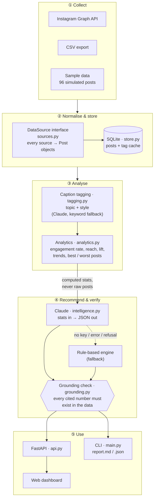
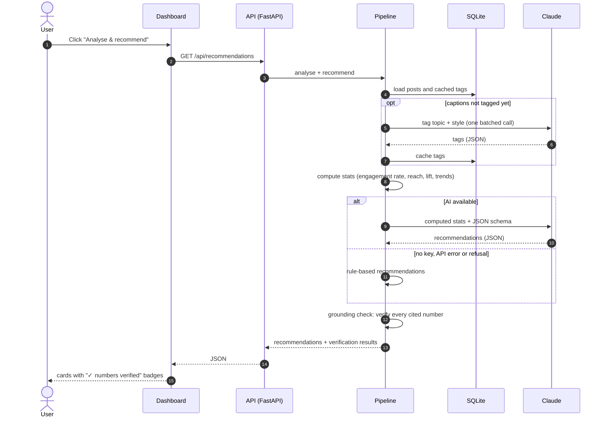

# Technical overview

## What it does

ICIS answers one question for an Instagram account: **what should we post next, and why?** It does this in four steps:

1. Collect post data.
2. Measure what performs.
3. Turn the measurements into recommendations.
4. Check that those recommendations are actually backed by the data.

## Architecture

Every component has one job and talks to the next through plain data: a list of `Post` objects, then a stats dictionary, then a recommendations dictionary. `pipeline.py` wires them together once, and the CLI and the API both call it, so they can't drift apart.

| Component | Responsibility | Key decision |
|---|---|---|
| `models.Post` | One normalised shape for a post | Every source maps onto it, so nothing downstream knows where data came from. Timestamps are stored as UTC |
| `sources.py` | Instagram API, CSV, sample data | Behind a `DataSource` interface: adding TikTok or a social media tool means one new class |
| `store.py` | SQLite | Upserts, so re-syncing refreshes metrics without duplicating posts. Caption tags are cached by caption hash. Each source gets its own database, so sample data never mixes with a real account |
| `tagging.py` | Topic + content style for each caption | Claude in one batched call, cached. Keyword rules as fallback |
| `analytics.py` | Metrics, group comparisons, trends, best/worst posts | Pure functions over a DataFrame, easy to test |
| `intelligence.py` | Recommendations | Claude gets computed stats, not raw posts. A rule-based engine produces the same output shape |
| `grounding.py` | Verifies recommendations | Every number cited must exist in the data |
| `llm.py` | The only module that calls Claude | Shared guardrails: JSON schema, refusal and truncation checks, a single error type that triggers the fallbacks |

### Request flow: "Analyse & recommend"

What happens when someone clicks **Analyse & recommend** in the dashboard. The CLI follows the same path without the browser and API.

## Data collection

**Fields collected:** post ID, caption, type (Reel, carousel or image), publish time, likes, comments, and from the insights endpoint: reach, saves, shares and views.

Decisions:
- **Two token types are supported.** Meta issues Instagram Login tokens (`IG…`, for `graph.instagram.com`) and Facebook or system-user tokens (`EA…`, for `graph.facebook.com/{ig-user-id}`). We hit the second one in practice, so the source detects the token type and picks the right host.
- **Insights are requested in one batched call per post.** If Meta rejects a metric (they rename and deprecate them), the source falls back to one call per metric. An unsupported metric becomes 0 instead of failing the whole sync.
- **Rate limits and server errors are retried with backoff.** Other errors fail fast with a clear message, and the token is removed from any error text.
- **Sample data** was generated with known patterns built in: tutorials perform best, promos worst, Reels reach most people, and evenings beat mornings. This makes it possible to *test* the analysis, because a test can check that the system finds patterns we know are there (`tests/test_pipeline.py`).

## Metrics: what we measure and why

| Metric | Definition | Why |
|---|---|---|
| **Engagement rate (ER)**, the primary metric | (likes + comments + saves + shares) ÷ **reach** | Measures how much the people who *saw* the post cared. Dividing by followers would penalise posts that reached beyond the follower base, and would reward posts that reached nobody |
| **Reach**, tracked separately | Unique accounts that saw the post | ER and reach answer different questions. Timing and hashtags mostly change *how many* people see a post; topic and format change both. Reporting both prevents advice like "post in the morning" when mornings only have higher ER because fewer people saw those posts |
| **Lift** | Group average ÷ account average | Makes comparisons readable ("tutorials: 1.29x your average") and comparable across accounts of any size |
| **Save rate, share rate** | Saves or shares ÷ reach | Saves and shares signal stronger intent than likes, and Instagram ranks on them. Shown as headline numbers |
| **Trend** | ER and reach in the earlier half of posts vs the recent half, plus monthly figures | Shows whether the account is improving, without overreacting to a single month |

Guardrails on the numbers:
- **Posts with reach under 10 get no ER.** Meta reports reach of 0–1 on some older posts, which produced a 1500% engagement rate on a real account during development.
- **Groups with fewer than 3 measurable posts** are flagged unreliable and never used for recommendations.
- **Accounts with fewer than 10 measurable posts** get a 4-week testing plan instead of patterns, because patterns from 2 posts would be noise presented as insight.

**Groups compared:** format, topic, content style, weekday, time of day, hashtag count, caption length, call to action, whether the caption asks a question, and emoji use.

## Intelligence layer

**Input: computed stats, not raw posts.** The LLM receives the stats dictionary (group tables with lifts, trends, best and worst posts) plus the rule-based insights. This is exposed at `/api/llm-input` and in the dashboard under "Data the intelligence layer received". Sending stats instead of posts:
- keeps the model reasoning over measured facts rather than guessing patterns itself
- keeps prompts small and cheap however many posts there are
- makes every claim traceable to a number

**Output: structured JSON**, constrained by a JSON schema (`output_config.format`). Each recommendation includes:
- format, topic, style, day and time
- a post idea and a caption draft
- hashtags
- whether it aims to grow engagement, reach or both
- `evidence` (the numbers it relies on)
- `based_on_posts` (the IDs of the proven posts it builds on)

The output also lists underperforming areas, each with a suggestion.

**Grounding check** (`grounding.py`). LLMs can state convincing numbers that don't exist. After recommendations are generated, by Claude or by rules:
- every number in each `evidence` field is extracted and looked up in the stats. A multiplier ("1.33x") must match a real lift, a percentage must match a real rate or change, and a count must match a real count or reach figure
- the summary and the evidence for each underperforming area are checked the same way
- `based_on_posts` IDs must be real posts
- the format must exist in the data

The dashboard shows a badge on each recommendation: "✓ 8/8 numbers verified", or "⚠ not verified: 3.47x not in data". This check is deliberately simple: it catches invented statistics, which is the failure that matters most here, but it can't judge whether the reasoning is sound.

**Fallbacks.** With no API key, a refusal, a timeout, invalid JSON or any other API error, the system uses the rule-based engine, which produces the same output shape from the same stats. The system therefore always produces a report. The engine used is always shown, so nobody mistakes rule-based output for AI output.

**Caption tagging.** The keyword rules for topics were written for the sample data, so on a real account most posts would land in "other". When a key is configured, Claude labels each caption with a topic (a free-text label, kept to a small set so groups stay comparable) and a style from a fixed list. All captions go in one batched call. Results are cached in SQLite by caption hash, so re-running the analysis costs nothing until captions change.

**Model:** `claude-opus-5-5`, set by `CLAUDE_MODEL`. Effort is "medium" for recommendations and "low" for tagging. A server-side fallback model is enabled for safety-classifier refusals.

## Reliability and testing

- **30 tests, covering:**
  - the Instagram source against fake responses: pagination, both token types, the per-metric fallback, retries, and that the token never leaks into errors
  - CSV validation
  - analytics against the planted sample patterns
  - small-account handling
  - the Claude path with a fake client: what is sent, the grounding of real vs invented numbers, refusal and invalid-JSON fallbacks
  - the tagging cache
  - the API end to end
- Tests never use real credentials (`conftest.py` removes them) or the network.
- The API returns clear errors for a missing token, an unknown source, or no data yet.

## Trade-offs and limitations

- **Correlation, not causation.** "Tutorials get 1.29x engagement" doesn't prove tutorials *cause* it. That's why recommendations are framed as things to try, and why the testing plan exists.
- **Small samples.** Thresholds of 3 posts per group and 10 per account are pragmatic minimums, not statistical significance. A next step would be confidence intervals.
- **Instagram data quality.** Insights only exist from the time an account became Business or Creator. Older posts can report near-zero reach, which is why low-reach posts are excluded from ER.
- **The grounding check verifies numbers, not reasoning.** A recommendation can cite real numbers and still draw a weak conclusion.
- **Keyword tagging is weak on real accounts.** AI tagging fixes this when a key is set.
- **Posting times** use the timezone in `ACCOUNT_TIMEZONE`, or UTC if it isn't set.
- **SQLite and a single process** are fine for a prototype. Multiple accounts would need an account dimension and a real database.

## Next iteration

1. **Feedback loop:** record which recommendations were posted, then score them against the prediction. This turns the system from advice into an experiment loop.
2. **Statistical confidence** on lifts (bootstrap intervals), shown in the UI.
3. **Scheduled syncs** with metric snapshots, to track each post's growth curve.
4. **Competitor benchmarks** through the Business Discovery API.
5. **Multi-account support** and authentication, so the dashboard can be shared.
6. **Visual analysis:** use the model's vision input to tag thumbnails (faces, text overlays, colours) as additional content-style signals.
